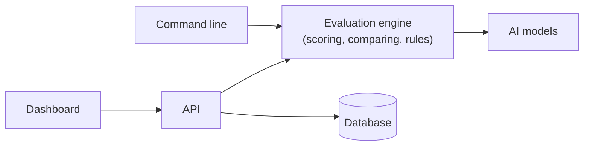

# LLM Evaluation and Monitoring Platform

Test your AI app before you ship it.

You give it a list of questions with the answers you expect. It sends the
questions to one or more AI models, scores every answer, and shows you
which model did better, which answers got worse, and whether the results
are good enough to release.

> **v0.1.0, portfolio project.** There is no login yet, so run it on your
> own computer only. The demo uses fake models, so its scores are
> examples, not benchmarks.


## What you can do with it

-   **Score answers**: exact match, word overlap, meaning similarity,
    speed, and estimated cost.
-   **Score RAG apps**: check whether the right documents were found and
    whether the answer sticks to them.
-   **Use an AI as a judge**: let a model rate answers from 1 to 5
    (treat these as estimates).
-   **Compare runs**: see what got better or worse against a saved
    baseline.
-   **Block bad releases**: set rules such as "accuracy must stay above
    80%" and fail the CI build when a rule breaks.
-   **Work the way you like**: a command-line tool, a REST API, or a web
    dashboard.

It works with Anthropic, OpenAI, and any OpenAI-compatible server. A
built-in **fake model** lets you try everything with no API key and no
internet.

## Try it in 2 minutes (no API key needed)

You need Python 3.12+ and [`uv`](https://docs.astral.sh/uv/).

``` bash
git clone <this repository's URL>
cd llm-evaluation-platform
uv sync --all-groups

uv run llm-eval run --config evals/demo_config.yaml
```

This scores two fake models on 21 questions and writes a report to
`reports/demo-run.md`. Open it to see the results.

More things to try:

``` bash
# Check for regressions against a saved baseline
uv run llm-eval compare --baseline evals/baselines/demo-baseline.json \
  --candidate reports/demo-run.json --fail-on-regression

# RAG demo: a model that sticks to the documents vs. one that makes things up
uv run llm-eval run --config evals/demo_rag_config.yaml --gates evals/gates.rag.yaml
```

Each command exits with `0` when everything passes and `1` when a rule
fails, so you can use it directly in CI.

## Run the dashboard

You also need Docker and Node.js 20+.

``` bash
cp .env.example .env              # Windows: copy .env.example .env
docker compose up -d --build      # starts the database, API and worker

cd frontend
npm ci
npm run dev                       # open http://127.0.0.1:5173
```

To fill it with demo data, run `uv run python scripts/seed_demo.py` from
the project folder.

| Project page | Run results |
|---|---|
|  |  |

## Use your own data

Write your questions in a JSON file:

``` json
{
  "schema_version": "1.0",
  "name": "my-questions",
  "cases": [
    {
      "case_key": "capital-france",
      "input": {"question": "What is the capital of France?"},
      "expected_output": "Paris"
    }
  ]
}
```

Then copy `evals/demo_config.yaml`, point it at your file, and pick your
models and metrics. To use a real model, put its API key in `.env` (never
commit this file). See [`datasets/`](datasets/) for more examples and
[`docs/providers.md`](docs/providers.md) for model setup.

## How it works



The command line and the API use the same engine, so results are the
same everywhere.

Built with Python (FastAPI, SQLAlchemy, Celery), PostgreSQL, Redis,
React, and TypeScript.

## Good to know

-   **No login yet.** Anyone who can reach the API can see results and
    start runs that cost money. Keep it on `127.0.0.1`.
-   **Scores are a guide, not proof.** No single number tells you an
    answer is correct. Check important results yourself.
-   **API keys stay private.** They are read from environment variables
    and are never saved, shown, or logged.
-   **Your data is stored.** Questions and answers are saved with the
    results, so don't use confidential data.

## Learn more

| Document | What's inside |
|---|---|
| [`docs/metrics.md`](docs/metrics.md) | What each score means, and how rules work |
| [`docs/providers.md`](docs/providers.md) | Connecting real models and API keys |
| [`docs/ci.md`](docs/ci.md) | Adding checks to your CI pipeline |
| [`docs/api.md`](docs/api.md) | REST API reference |
| [`docs/architecture.md`](docs/architecture.md) | How the system is built |
| [`docs/threat-model.md`](docs/threat-model.md) | Security risks and protections |

## License

[MIT](LICENSE) © 2026 hasseb01 and anasfwp.
