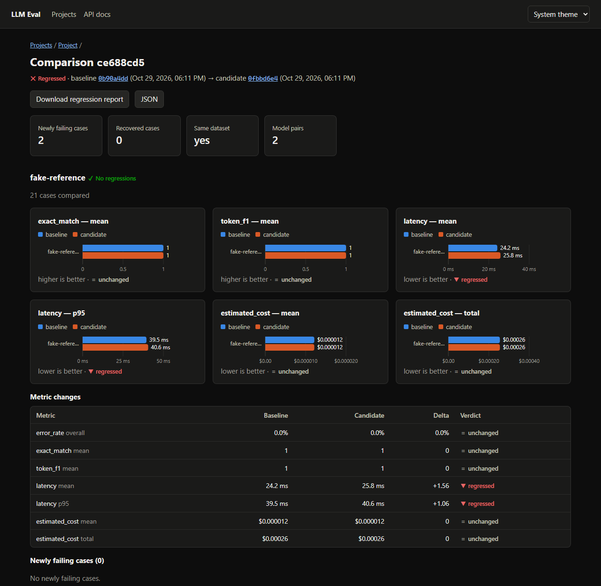
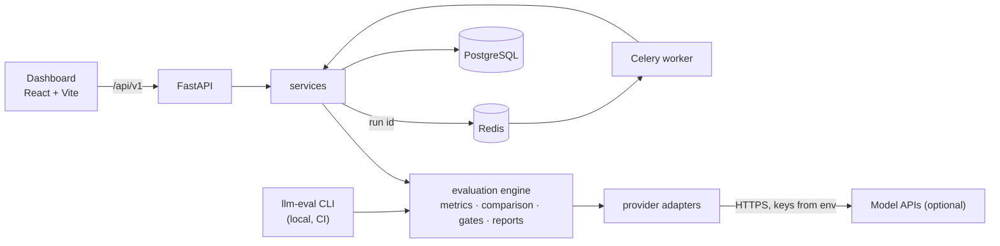
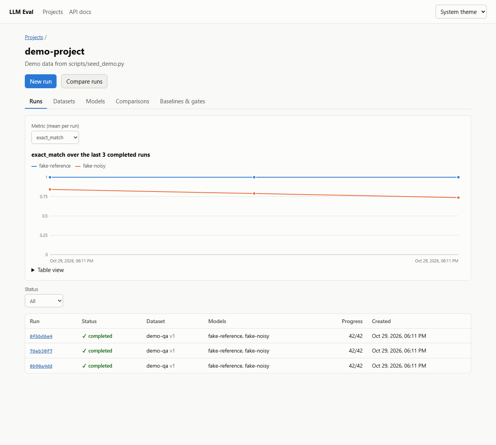
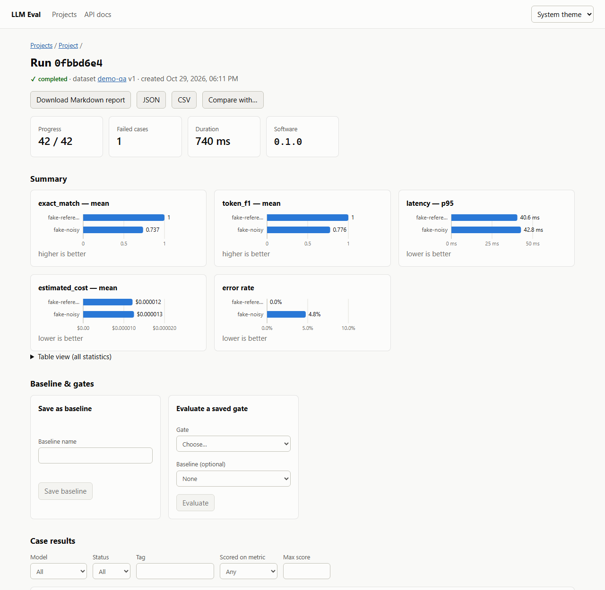

# LLM Evaluation and Monitoring Platform

Evaluate LLM and RAG applications on answer quality, retrieval quality,
reliability, latency, and estimated cost. Run repeatable experiments,
compare models and prompt versions against a baseline, inspect failing
cases, and block regressions in CI.

> **Status: v0.1.0, a portfolio project.** Everything listed under
> [What it does](#what-it-does) is implemented and tested. The API has
> **no authentication**: run it on localhost only (see
> [Limitations](#limitations)). Scores and costs from the demo data are
> illustrative, not benchmark results.



## What it does

-   **Datasets**: JSON/JSONL, schema 1.0, validated case by case before
    import; versioned with a content hash; tags, reference answers,
    reference context, recorded retriever rankings and relevance labels.
-   **Models**: a deterministic `fake` provider (no network, no
    credentials, can simulate wrong answers and provider errors),
    `anthropic`, `openai`, and `openai_compatible` (vLLM, llama.cpp,
    LiteLLM, Gemini, ...). Token usage, timeouts, bounded retries that
    honour `Retry-After`, normalized error codes. See
    [`docs/providers.md`](docs/providers.md).
-   **Metrics** (versioned; `not_applicable` when inputs are missing):
    `exact_match`, `token_f1`, `semantic_similarity` (embeddings),
    `latency`, `estimated_cost` (versioned pricing frozen into each run),
    `retrieval_precision_at_k`, `retrieval_recall_at_k`,
    `reciprocal_rank`, and LLM-as-judge `correctness`, `relevance`,
    `instruction_adherence`, `groundedness`, `context_relevance` on
    versioned 1–5 rubrics, with a deterministic fake judge for CI. See
    [`docs/metrics.md`](docs/metrics.md).
-   **Runs**: bounded concurrency, partial-failure handling, cancellation,
    case-level results with outputs, errors, latency and usage; JSON,
    CSV and Markdown reports that record dataset hash, config hash,
    metric versions and software version.
-   **Comparisons and gates**: align two runs by case key, report metric
    deltas with direction-aware verdicts, newly failing and recovered
    cases; absolute, baseline-relative and per-tag gate rules with an
    explicit missing-data policy; named baselines.
-   **Three ways in**: the `llm-eval` CLI (`validate | run | gate |
    compare | metrics list`, CI-friendly exit codes), a REST API with a
    Celery worker ([`docs/api.md`](docs/api.md)), and a React dashboard.

## Architecture



The CLI and the worker share one engine, so a gate that passes locally
passes in CI and through the API. Details, the run lifecycle and design
decisions are in [`docs/architecture.md`](docs/architecture.md).

| Area | Technology |
|---|---|
| Backend | Python 3.12, FastAPI, Pydantic 2, SQLAlchemy 2, Alembic |
| Jobs | Celery + Redis |
| Database | PostgreSQL (SQLite for tests and quick local runs) |
| Frontend | React 18, TypeScript, Vite, React Router |
| Quality | pytest, Vitest, Ruff, mypy (strict), TypeScript strict |
| Delivery | Docker Compose, GitHub Actions |

## Quick start

Prerequisites: Git, Python 3.12+, [`uv`](https://docs.astral.sh/uv/),
Docker (for the full stack), Node.js 20+ (for the dashboard). Provider API
keys are only needed for live evaluations.

### 1. Evaluate from the command line (no Docker, no keys)

``` bash
git clone https://github.com/<owner>/llm-evaluation-platform.git
cd llm-evaluation-platform
uv sync --all-groups
uv run pytest                                            # backend test suite

uv run llm-eval validate --config evals/demo_config.yaml
uv run llm-eval run --config evals/demo_config.yaml     # writes reports/demo-run.json and .md
uv run llm-eval compare --baseline evals/baselines/demo-baseline.json \
  --candidate reports/demo-run.json --fail-on-regression
uv run llm-eval run --config evals/demo_rag_config.yaml --gates evals/gates.rag.yaml
```

-   `demo_config.yaml`: 21 known-answer questions, two fake models.
    `fake-reference` returns the reference answers; `fake-noisy` gives
    three wrong answers and hits one simulated rate limit. Both pass the
    example gate; tighten a threshold in `evals/gates.example.yaml` to see
    exit code `1`.
-   `demo_rag_config.yaml`: a small RAG set with recorded retriever
    rankings and relevance labels, scored with retrieval metrics,
    `token_f1`, and a (fake) groundedness judge that separates a grounded
    model from a hallucinating one.

Exit codes: `0` pass, `1` gate failed or regression found, `2` invalid
input, `3` run failure, `4` internal error.

### 2. Run the API, worker and dashboard

``` bash
cp .env.example .env            # Windows: copy .env.example .env
docker compose up -d --build    # PostgreSQL, Redis, migrations, API, worker (127.0.0.1 only)

cd frontend
npm ci
npm run dev                     # http://127.0.0.1:5173, proxies /api to the API
```

Load demo data while the stack is up: `uv run python scripts/seed_demo.py`
(one project, the demo dataset, two fake models, three runs, a baseline,
a gate and a comparison). API docs: `http://127.0.0.1:8000/docs`.

<details>
<summary>Without Docker</summary>

Run the API from your checkout against PostgreSQL and Redis:

``` bash
uv run alembic upgrade head
uv run uvicorn app.main:create_app --factory --app-dir backend --reload --port 8000
uv run celery --workdir backend -A app.workers.celery_app worker --loglevel INFO
```

For a quick look with neither, use SQLite and run evaluations inside the
API process (development only; refused when `APP_ENV=production`):

``` bash
export DATABASE_URL=sqlite:///./local.db RUN_DISPATCHER=inline
uv run alembic upgrade head
uv run uvicorn app.main:create_app --factory --app-dir backend --port 8000
```

</details>

## Dashboard

| Project runs and quality trend | Run summary |
|---|---|
|  |  |

-   **Projects** with runs, datasets, models, comparisons, and baselines &
    gates tabs; a per-model quality trend across runs.
-   **Runs**: start one (dataset, models, metrics, concurrency), watch
    progress, cancel, see per-metric charts, filter case results by model,
    status, tag or score, and download Markdown, JSON or CSV reports.
-   **Datasets**: import, browse versions and cases, export.
-   **Comparisons**: metric deltas with verdicts, newly failing and
    recovered cases, per-case score changes, regression report download.
-   **Baselines & gates**: save a run as a baseline; evaluate saved gates.
-   Accessible: every chart has a table view and keyboard tooltips, state is
    never shown by colour alone, light and dark themes, phone-width layout.
    API keys are never entered in or shown by the dashboard.

## Datasets

``` json
{
  "schema_version": "1.0",
  "name": "rag-qa",
  "cases": [
    {
      "case_key": "returns-window",
      "input": {"question": "How many days do customers have to return an unused item?"},
      "expected_output": "30 days",
      "retrieved_contexts": [
        {"document_id": "policy-returns", "text": "Unused items can be returned within 30 days...", "score": 0.91},
        {"document_id": "policy-shipping", "text": "Standard shipping takes 3 to 5 business days.", "score": 0.42}
      ],
      "relevant_document_ids": ["policy-returns"],
      "tags": ["policy"]
    }
  ]
}
```

`case_key` must be stable: comparisons align runs by it. Retrieval
metrics need explicit `relevant_document_ids`; relevance is never inferred
from answer text. Full examples: [`datasets/`](datasets/).

## Interpreting results

| Metric | Tells you | Watch out for |
|---|---|---|
| Exact match | Normalized output equals the reference | Too strict for open-ended answers |
| Token F1, semantic similarity | Word or embedding overlap with the reference | Similar is not the same as correct |
| LLM-as-judge | A model's rubric rating (1–5) | An estimate; can be inconsistent, biased or manipulated. Rubric and judge model are recorded |
| Precision@k, Recall@k, reciprocal rank | Quality of the retrieved ranking | Only as good as the relevance labels |
| Groundedness | Whether claims are supported by the context | Needs the actual context; judge-based |
| Latency | Mean, median, p95 per model | Small samples make percentiles indicative only (flagged under 20 cases) |
| Estimated cost | Usage × versioned prices | Not a bill; usage or prices may be missing or change |

No single score is a complete measure of quality. Keep per-metric results
and error rates visible, and use human review for high-impact decisions.

## Quality gates and CI

Gate files are YAML ([`evals/gates.example.yaml`](evals/gates.example.yaml),
[`evals/gates.regression.yaml`](evals/gates.regression.yaml)):

``` yaml
missing_metric_policy: fail        # missing data never passes silently
rules:
  - {metric: exact_match, aggregation: mean, operator: gte, threshold: 0.8}
  - {metric: exact_match, aggregation: mean, kind: relative, max_regression: 0.02}
  - {metric: latency, aggregation: p95, kind: relative, max_regression: 20, regression_unit: percent}
  - {metric: exact_match, aggregation: mean, tag: geography, operator: gte, threshold: 1.0}
```

This repository's CI (`.github/workflows/ci.yml`) runs on every push and
pull request without any paid API key: lint, type checks and tests
(backend and dashboard), the demo evaluation with its gate, a regression
gate and report against the committed baseline, migrations and API tests
on PostgreSQL, a container build, a gitleaks secret scan, and pip/npm
dependency audits. A copy-paste workflow for your own project is in
[`docs/ci.md`](docs/ci.md).

## Security and privacy

See the [threat model](docs/threat-model.md). In short:

-   API keys are read from environment variables named in an allowlist;
    they are never stored, returned by the API, or logged. Logs and
    stored error messages are redacted.
-   Outbound targets come only from operator-set environment variables
    (SSRF), and every run is bounded (cases, models, concurrency,
    timeouts, retries, judge call budget).
-   Model output is never executed and is rendered as text.
-   Treat prompts, contexts and outputs as confidential: they are stored
    with results. Use datasets you may redistribute.

## Limitations

-   **No authentication or authorization.** Anyone who can reach the API
    can read results and start runs that spend provider credits. All
    ports bind to `127.0.0.1`; do not expose them.
-   No data-retention window or option to skip storing raw prompts and
    outputs; projects are archived, not deleted.
-   Judge-based scores are estimates, and the bundled fake judge is a
    lexical heuristic for tests and demos only.
-   Pricing covers a small set of models; other models report cost as
    not applicable.
-   No streaming, multi-turn conversation, or tool-use evaluation yet.

## Roadmap

-   [x] Phase 0: project skeleton, config, linting, tests, CI
-   [x] Phase 1: fake provider, dataset validation, core metrics, CLI, JSON report
-   [x] Phase 2: FastAPI, PostgreSQL persistence, migrations, background worker
-   [x] Phase 3: hosted and OpenAI-compatible providers, token usage, cost estimation
-   [x] Phase 4: judge, retrieval and similarity metrics
-   [x] Phase 5: run comparisons, baselines, quality gates, CI integration
-   [x] Phase 6: React dashboard and report exports
-   [x] Phase 7: end-to-end tests, RAG demo, architecture and threat model,
    secret and dependency scanning, documentation, release
-   [ ] Next: authentication and per-project access, retention controls,
    conversation and tool-use evaluation

## Documentation

| Document | Contents |
|---|---|
| [`docs/architecture.md`](docs/architecture.md) | Components, run lifecycle, design decisions |
| [`docs/metrics.md`](docs/metrics.md) | Metric definitions, gates, comparison rules |
| [`docs/providers.md`](docs/providers.md) | Provider adapters, credentials, allowlist |
| [`docs/api.md`](docs/api.md) | REST API reference |
| [`docs/ci.md`](docs/ci.md) | CI integration and exit codes |
| [`docs/threat-model.md`](docs/threat-model.md) | Assets, threats, mitigations, open risks |
| [`REQUIREMENTS.md`](REQUIREMENTS.md) | Product and technical requirements |

## License

Choose and add a license before publishing. Do not imply that the
repository is open-source under a particular license until the `LICENSE`
file exists. The demo datasets were written for this repository.

## Disclaimer

Scores and cost figures are only as reliable as the dataset, metric
definitions, judge model, usage metadata, and pricing configuration.
This platform is an evaluation aid, not a guarantee of correctness or
safety.
