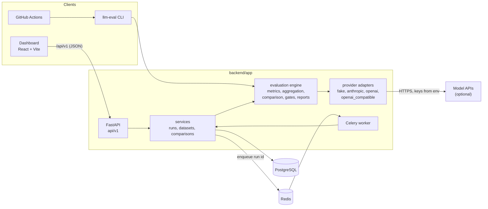
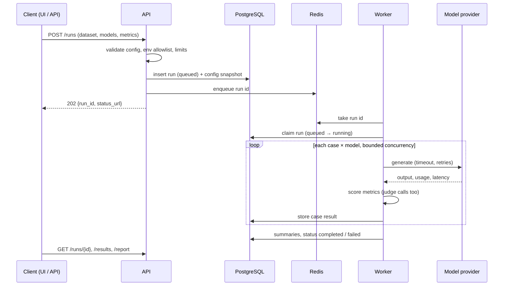

# Architecture

The platform has one evaluation engine with three entry points: the CLI
(local runs and CI), the REST API with its background worker, and the
dashboard, which is only a client of the API.

## Run lifecycle

The CLI runs the same engine in-process: no database or queue is needed,
which is why CI can evaluate and gate with the fake provider only.

## Components

| Path | Responsibility |
|---|---|
| `backend/app/domain` | Pydantic models shared by every entry point: datasets, run config, reports, gates, comparisons. No I/O. |
| `backend/app/evaluation` | The engine (`engine.py`), metric implementations and registry, aggregation, comparison, gate evaluation, Markdown/JSON reporting, pricing. |
| `backend/app/providers` | One adapter per provider behind a common interface; error normalization; credentials read from allowlisted environment variables. |
| `backend/app/services` | Use cases for the API: validation against settings, persistence, dispatch. |
| `backend/app/db` | SQLAlchemy models and repositories; Alembic migrations in `backend/alembic`. |
| `backend/app/api` | HTTP layer: routing, request IDs, error envelope, CORS, size limits. |
| `backend/app/workers` | Celery app and the run task. `RUN_DISPATCHER=inline` runs in-process for tests and local demos. |
| `backend/app/cli` | `llm-eval validate / run / gate / compare / metrics`. |
| `frontend/` | Dashboard. Talks only to `/api/v1`; never sees credentials. |

## Design decisions

- **Reproducible runs.** Each run stores a snapshot of its resolved
  configuration, dataset content hash, metric versions and pricing table.
  Reports and comparisons are computed from stored results, never by
  re-calling models.
- **Versioned metrics.** A metric's name and version identify its
  behaviour. Comparisons and relative gates refuse to compare different
  versions or configurations.
- **Explicit "not applicable".** A metric that lacks its inputs (no
  reference answer, no relevance labels) records `not_applicable` rather
  than a zero, and aggregates exclude it.
- **Deterministic by default.** The fake provider and fake judge make
  the demo, the tests and CI free and repeatable. Hosted providers are
  opt-in through configuration and environment variables.
- **Bounded work.** Concurrency, timeouts, retries, case and model limits,
  request size and judge call budgets are all capped by validated settings.
- **One engine, several front ends.** CLI and worker share the engine, so
  a gate that passes locally passes in CI and in the API.
